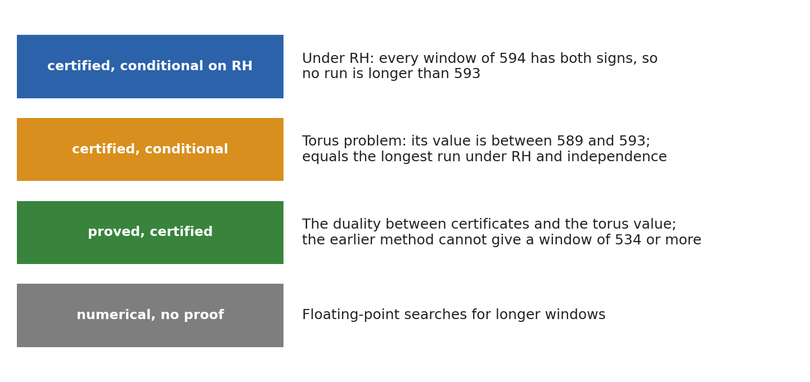

DOI of this text: [doi:10.5281/zenodo.24577243](https://doi.org/10.5281/zenodo.24577243)

This is an introductory text to the research paper *The longest sign run of Keiper-Li second differences: a torus problem and its dual* [[Per26]](https://doi.org/10.5281/zenodo.24517615), by the same author. The paper has the proofs and the full computations. This note has the idea. No equations are needed to follow it. It makes no claim the paper does not make, and for each claim it says whether it is proved, certified by computer with error bars, or only computed.

One caution comes first. **Every result of the paper about the actual sequence is conditional.** They assume the Riemann hypothesis (RH), whose announced proof is described just below, and the lower bound also needs a second, unproved hypothesis about independence. The paper does not prove RH and it does not disprove it.

> **Status as of 27 November 2026:** on 20 November 2026 Levent Alpöge announced a proof of the Riemann hypothesis, found with Claude and released as a Lean 4 formalization of about 17 million lines, which the Lean FRO and the Mathlib Initiative certified on 21 November after checks by the Lean kernel and independent checkers; no complete human-readable proof has been published and no peer review by mathematicians has been reported, so the proof is machine-checked and human verification is still under way. If that proof is accepted, the paper's results T1 to T5 (its own numbering) hold without assuming RH. T6, the positive density of runs of 589 in $c_n$, would still need $\mathrm{LI}_\theta(2\cdot10^5)$, which the announced result does not supply, and so would the equality in T1 and the two-sided reading of T5 for $c_n$. This note says neither that RH is open nor that it is proved.

# Where the earlier papers stopped

The Riemann zeta function has famous zeros, and RH says that they all lie on one straight line. A list of numbers $\lambda_1, \lambda_2, \lambda_3, \dots$, the **Li coefficients**, is computed from those zeros. Think of the list as the heights of points on a curve. The **second difference** $c_n$ measures how that curve bends at the point $n$: positive means it bends upward like a bowl, negative means it bends downward like a hill.

The first companion paper [[Per26a]](https://doi.org/10.5281/zenodo.24447746) showed that $c_n$ is positive for the first 117 steps and then changes sign, and that it changes sign again and again. The second [[Per26b]](https://doi.org/10.5281/zenodo.24486137) asked how long a stretch of one sign can be. A **run** is a maximal block of consecutive $n$ where $c_n$ has one sign. That paper showed, under RH, that no run is longer than 621 (**certified, conditional on RH**), and, under RH and an independence hypothesis on the first 1400 wave angles, that runs of 476 keep coming back (**conditional, computer-assisted**). So the longest run was somewhere between 476 and 621, with a hypothesis needed for the lower end.

The present paper narrows that gap a great deal. The question of the title is how close the two ends can be brought.

# The idea: let the waves choose their own timing

Under RH, each zero of zeta contributes one wave to $c_n$, a cosine of its own speed. The sequence $c_n$ is the sum of all the waves. At step $n$ each wave is at some phase, which is its position within its cycle, and the phases of all the waves at step $n$ are fixed numbers.

Here is the new idea. Forget for a moment that the phases at step $n$ are fixed. Let every wave start from an **arbitrary** phase instead. This is the **torus problem**: a sum of the same waves, with the same speeds and the same weights, but with free starting phases. (The word torus is the name for the space of all possible phase choices.) Every run of the real sequence is a window of this model at one particular choice of phases, so the longest run of $c_n$ is **at most** the longest window of the model. This is **proved** under RH. If the wave angles are independent of each other, a classical theorem of Weyl says the phases at step $n$ wander over all choices, and then the two are **equal** (**proved**, under RH and the independence hypothesis, called $\mathrm{LI}_\theta$).

The torus problem is cleaner than the original. It has a **lower side**, a search for phases that make a long window, and an **upper side**, a search for weights that prove that no long window exists. The paper works on both sides and proves how they relate.

{width=84%}

# The upper side: no run is longer than 593 (under RH)

The upper side asks for a proof that no window of 594 steps can keep one sign. The earlier paper used a **comb**: a handful of weights, the same whatever the phase of the first wave, placed at the troughs of the first wave. Adding the values of $c_n$ at the troughs with those weights gives a sum that must be negative if the window is positive, and a contradiction follows.

The paper shows first that such fixed weights have a limit. It proves, with no hypothesis beyond the model, that **fixed weights certify nothing at all**: the sum, with the allowance for the unlisted zeros included, averages to a positive number over the phases, so a single comb cannot rule out every phase choice (**proved**). Weights that are allowed to depend on the phase of the first wave do better, and the best of them correspond exactly to a relaxation of the torus problem (**proved**). That tells us what such a method can and cannot do.

The new certificate uses this. It splits the possible phases of the first wave into **48 arcs**, a vector of weights for each arc, spread over the whole window of 594 steps. For each arc a ratio is computed, and the ratio must stay below 1 for the weights to work. The computation uses the first 2000 zeros, each checked with error bars, and a bound for all the others. The result is **certified, conditional on RH**: every window of 594 consecutive steps contains both a positive and a negative value, so every run is at most 593.

{width=84%}

The paper's own count of arcs is 48, one for each weight vector. In the data file that draws the figure, three arcs cross the end of the axis and are drawn in two pieces, which makes 51 curves for 48 arcs. In fact only a chain of 22 of the arcs is needed to cover every phase, and the smallest overlap in that chain is about $0.017$ in the angle measure. The paper notes that the cover is not tight: removing one or two vectors still works.

# The lower side: a window of 589 (under RH and a zero count)

The lower side asks for phases that make a long window positive. The paper searches by computer for phases, and then **certifies** the result in ball arithmetic. The key is that the waves of the zeros beyond the 1400th are slow compared with the window, so one common phase choice nearly achieves their best possible effect (**proved**, the alignment lemma). The phases found give a window of 589 steps on which the sum stays positive, and the certificate checks this with a margin, the smallest value the sum takes over the window, of about $5.5\cdot10^{-5}$.

This is **certified, conditional on RH and on a trusted zero count** for the first 1400 zeros. The count comes from the software that locates the zeros, and the paper says plainly that it trusts that count and does not certify it. So the torus problem has value **between 589 and 593** (certified, conditional). The width of the bracket, five values, is **open**.

{width=84%}

# From the torus back to the sequence

A run of 589 in the torus problem is not yet a run of 589 in $c_n$. The torus lets the phases be anything, and the real sequence has its phases tied to the zeros. The paper is careful about this. Under RH alone, the upper bound 593 holds for $c_n$ itself. The lower bound 589 holds for $c_n$ **only under the independence hypothesis** $\mathrm{LI}_\theta$, which is **unproved and open**, and then the longest run equals the torus value.

There is one more result about the real sequence. Under RH, the trusted zero count and the independence hypothesis for all zeros up to height $200000$, runs of 589 positive values, and of 589 negative values, occur with **positive lower density** (**conditional**, with the tail certified). The paper gives no estimate of the density other than that it is positive. This needs far more independence than the earlier method, because the earlier method treats all the unlisted zeros as the worst case at every step. The paper shows that this earlier method **cannot** give a window of 534 or more, for any number of listed zeros up to 2000 (**certified**). That is why the new approach gets so much further.

# What is still numerical

Searches by computer for longer windows, started from random phases, are **numerical**: they are floating point, not proofs. In the model where the unlisted zeros are the worst case, they reach 477 for 1400 zeros and 489 for 2000. They sit below the certified limit of 533 for that model. The paper makes **no conjecture** about where in the bracket from 589 to 593 the true value lies, because it has no derivation that points to one. The paper also lists three routes that might close the gap, and none of them is done.

The paper also has a Lean 4 check. The exclusion of 534 for the earlier method is checked by the Lean kernel at 2000 zeros. The upper bound 593 is checked by the kernel together with 40 uses of `native_decide`, which means that the computer evaluates a finite check and the kernel trusts the evaluation. Both are checked under the hypotheses that each zero lies in its certified interval and that the stated tail bound holds.

{width=88%}

# What this note does not claim

It does not prove RH and it does not disprove it, and it takes no side on the announced proof (see the note at the top).

It does not say that the independence hypothesis is true, and it does not claim to know the longest run: that stays open between 589 and 593 for the torus problem, and for $c_n$ the lower end needs the hypothesis. It does not claim a complete survey of the literature. The paper says that the bracket, the number 593, the duality in the form stated, and the exclusion of 534 are new to the author's knowledge, and that weak duality and the comb of weights are classical in mechanism. Related work includes Haraux on almost periodic functions, Kozma and Oravecz on iterated averaging combs, and Rubinstein and Sarnak for the route from independence to the torus.

# Where to go next

- The paper itself [[Per26]](https://doi.org/10.5281/zenodo.24517615), with the proofs, the certificates, the Lean project and the scripts.
- The companion paper on the first sign change [[Per26a]](https://doi.org/10.5281/zenodo.24447746).
- The companion paper on sign runs and the density of sign changes [[Per26b]](https://doi.org/10.5281/zenodo.24486137).
- The public code and certificates, at [github.com/mik-tf/keiper-li-run-torus](https://github.com/mik-tf/keiper-li-run-torus).

# Use of AI {-}

Claude (Anthropic) was used in November 2026, under the author's direction, for drafting, figures and checks.

# Read the research paper {-}

```{=latex}
\raggedright
```

The full paper, with the proofs, is *The longest sign run of Keiper-Li second differences: a torus problem and its dual*, by Michaël Perreault.

DOI: [doi:10.5281/zenodo.24517615](https://doi.org/10.5281/zenodo.24517615)

```{=latex}
\par\ifdim\dimexpr\pagegoal-\pagetotal\relax<15\baselineskip\ifdim\pagetotal>0pt\newpage\fi\fi
```

# References {-}

[Per26] M. Perreault, *The longest sign run of Keiper-Li second differences: a torus problem and its dual*, 2026, Zenodo. [doi:10.5281/zenodo.24517615](https://doi.org/10.5281/zenodo.24517615).

[Per26a] M. Perreault, *Sign changes of Keiper-Li second differences*, 2026, Zenodo. [doi:10.5281/zenodo.24447746](https://doi.org/10.5281/zenodo.24447746).

[Per26b] M. Perreault, *Sign runs and the density of sign changes of Keiper-Li second differences*, 2026, Zenodo. [doi:10.5281/zenodo.24486137](https://doi.org/10.5281/zenodo.24486137).
